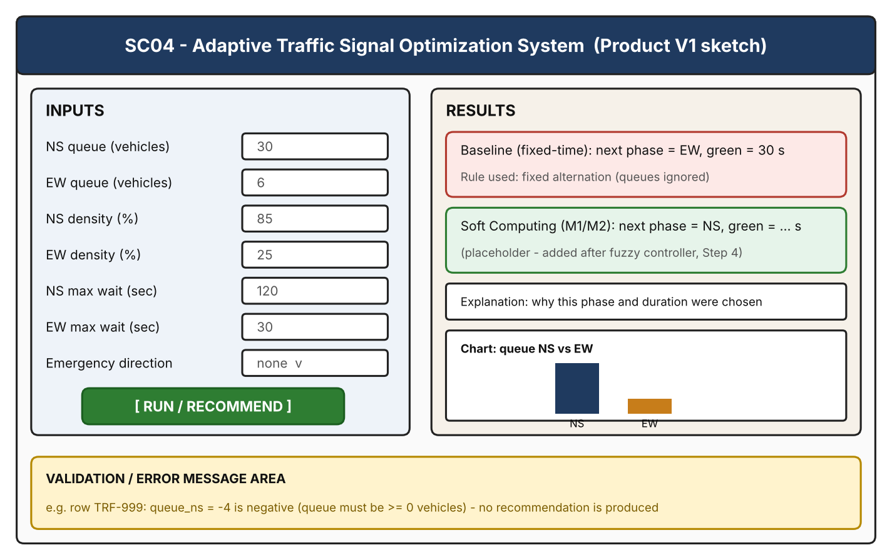

# Step 1 Project Contract

Project: **SC04 - Adaptive Traffic Signal Optimization System** | Team: **[TEAM NAME]**

## Team and responsibilities
- [Member 1] - Repository (+ Testing/UI for a team of 3): create folders, add members, test clone/run steps
- [Member 2] - Data: fields/units, 20-row sample, sources
- [Member 3] - Baseline: simple rules and expected results for five cases
- [Member 4] - Testing/UI: validation, screen sketch, evidence

First responsibilities only; every member must understand the complete Step 1.

## One-sentence problem
Given queues, density, waiting time, and emergency direction, choose the next phase and green duration.

## User of the product
A traffic operator studying one simple two-phase junction (North-South and East-West phases only).

## Inputs and units
| Field | Meaning | Type / unit | Rule |
|---|---|---|---|
| `state_id` | Unique traffic state name | text | `TRF-###`, unique |
| `queue_ns` | NS queue length | vehicles | whole number, 0 to 100 |
| `queue_ew` | EW queue length | vehicles | whole number, 0 to 100 |
| `density_ns_pct` | NS road occupancy | percent | 0 to 100 |
| `density_ew_pct` | EW road occupancy | percent | 0 to 100 |
| `max_wait_ns_sec` | Longest NS wait | seconds | 0 to 300 |
| `max_wait_ew_sec` | Longest EW wait | seconds | 0 to 300 |
| `emergency_direction` | Approach with emergency vehicle | category | `none`, `NS`, `EW` |

Missing values are rejected (never guessed). Full details: `data/README.md`.

## Outputs and units
| Output | Unit | Allowed |
|---|---|---|
| `next_phase` | category | `NS` or `EW` |
| `green_duration_sec` | seconds | safe minimum 10 s, safe maximum 60 s (TEMPORARY) |

## Baseline method
Fixed-time signal (rules 1-5; pseudocode in `docs/baseline-pseudocode.md`, runnable in `src/baseline.py`):
1. Start with NS green for 30 seconds (TEMPORARY).
2. Then use EW green for 30 seconds.
3. Continue alternating, even when one queue is longer.
4. If `emergency_direction` is not `none`, allow an explicit safety override in the test version (that direction gets green, 30 s).
5. Reject negative queues, density over 100, or wait above 300 s (TEMPORARY limit).

## Soft Computing method for M1
A fuzzy controller for one two-phase junction, compared with a fixed-time signal.

## Advanced method for M2
Use GA to tune the controller, test emergencies and heavy queues, and deploy the simulator.

## Dataset/scenario sources
- Step 1 sample: 20 **hand-written, simulated/illustrative** rows (`data/sample_input.csv`). Not real measured data. No external dataset, so no licence applies yet.
- Step 2 plan: reproducible seeded simulator producing 10,000+ states, labelled as simulated; add exact URLs, licences and what each source provided when used (e.g. SUMO: https://eclipse.dev/sumo/ - *planned, not used yet*).

## Five mandatory test cases
Full table in `docs/test-cases.md`.

| ID | Name | Input (qNS, qEW, dNS, dEW, wNS, wEW, emerg.) | What to check | Expected baseline |
|---|---|---|---|---|
| TRF-001 | Balanced low traffic | 5, 5, 20, 20, 25, 22, none | Accepted; nothing urgent | NS 30 s |
| TRF-002 | Heavy NS queue | 30, 6, 85, 25, 120, 30, none | Large NS queue and density | EW 30 s (cycle; wrong side) |
| TRF-003 | Heavy EW queue | 4, 28, 15, 80, 20, 115, none | Large EW queue and density | NS 30 s (cycle; wrong side) |
| TRF-004 | Long waiting time despite shorter NS queue | 8, 12, 30, 40, 190, 65, none | Wait time must matter | EW 30 s (ignores 190 s wait) |
| TRF-005 | Emergency must get priority | 20, 20, 60, 60, 90, 90, EW | Emergency decides | EW 30 s (rule 4) |
| INV-001 | Invalid/impossible case (`data/invalid_input.csv`) | -4, 10, 140, 30, 50, 40, none | Must be rejected | No output; error message |

## Product V1 screen sketch

Screen areas: inputs (NS/EW queue, density, wait, emergency), one **Run / Recommend** button, results (next phase,
green seconds, baseline phase, explanation, queue chart), and a validation-error strip. Baseline and (future)
Soft Computing outputs are shown side by side.
**Outside-person check:** [name of person] explained the screen as: "[their words]"; labels changed: [list or "none"].

## Risks and assumptions
- All data are hand-written/simulated; they may not match real junction behaviour. (assumption)
- Limits (queue 100, wait 300 s, green 10-60 s, fixed 30 s) are **temporary** and may change after faculty review.
- Baseline "cycle position = row order" is a testing assumption, not a real controller state. (temporary)
- Density definition (road-space occupancy) must be confirmed before Step 2.
- No amber/all-red clearance, pedestrians or turning movements are modelled.
- Emergency override in the baseline is a test-version safety rule only.
- Real-world traffic would need calibration; results apply only to this simulator.

## Step 1 completion evidence
Replace the placeholders with real links after pushing.

- [ ] Repository URL: [link] - collaborators: [list]
- [ ] `README.md`: [link]
- [ ] `docs/STEP-1.md` (this file): [link]
- [ ] `data/README.md`: [link]
- [ ] `data/sample_input.csv` (20 rows) and `data/invalid_input.csv`: [link]
- [ ] `docs/test-cases.md` (five cases + invalid case): [link]
- [ ] `docs/baseline-pseudocode.md`: [link]
- [ ] `src/validate_data.py` PASS output: `results/step1/validation_pass.txt` + screenshot [add screenshot file name]
- [ ] Expected FAIL output: `results/step1/validation_expected_fail.txt` + screenshot [add screenshot file name]
- [ ] `docs/product-v1-sketch.png`: [link]
- [ ] Commits from every member: [commit links]
- [ ] Three-minute demo rehearsed (`docs/faculty-demo-script.md`)
